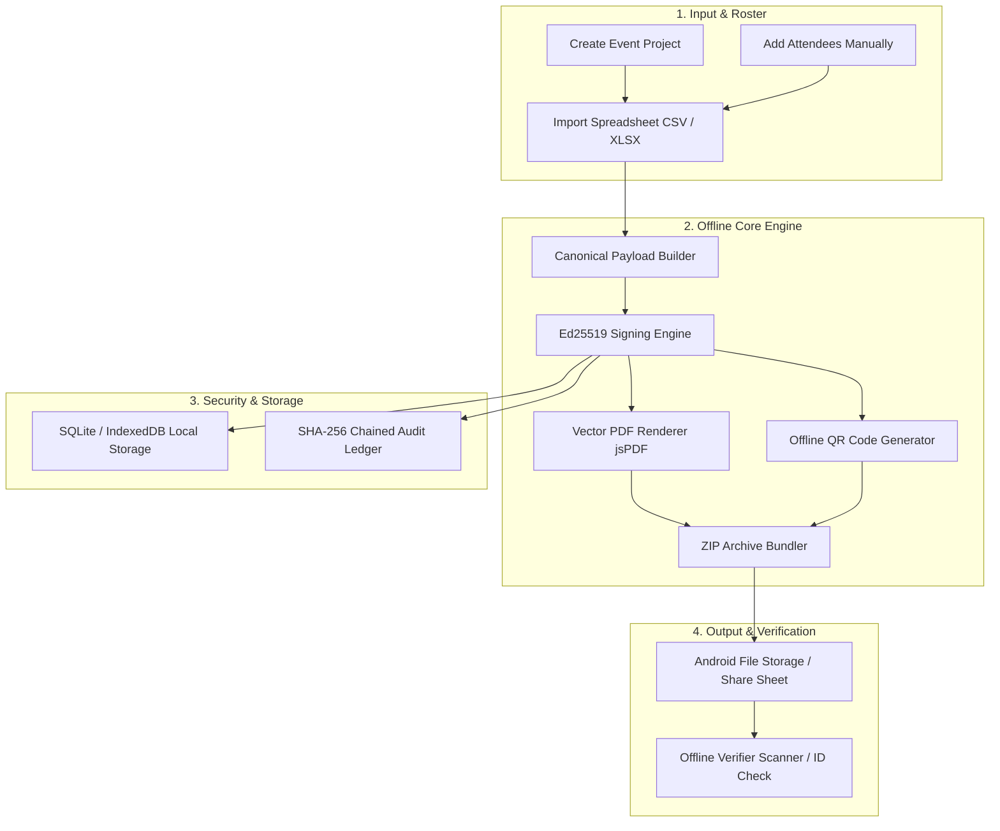

# CertiForge: User Manual & Application Guide
**Offline-First Bulk Certificate Generation, Management, and Cryptographic Verification System**

---

## 1. What is CertiForge?

**CertiForge** is an offline-first native Android application designed to generate, digitally sign, manage, and verify certificates in bulk. It is specifically tailored for:

* **College & University Events**
* **IEEE Student Branch Activities**
* **Technical Workshops & Seminars**
* **Hackathons & Coding Competitions**
* **Conferences & Symposiums**
* **Course Completion & Volunteer Appreciation Awards**

### The Core Philosophy
Traditional certificate generation tools rely on online web apps, cloud servers, or external subscription APIs. This introduces several risks:
1. **Network Dependency:** Event halls, auditoriums, and campus labs often suffer from congested or nonexistent Wi-Fi.
2. **Privacy Risks:** Student names, registration numbers, and email addresses are uploaded to third-party cloud databases.
3. **Forgery Vulnerability:** Typical printed or PDF certificates can be easily edited using Photoshop or PDF editors with zero tamper detection.

**CertiForge solves all three problems:**
* **100% Offline (Air-Gapped):** Generates PDFs, creates QR codes, computes digital signatures, and verifies records locally on your device with **zero** cloud servers or external API calls.
* **Cryptographically Tamper-Evident:** Every issued certificate is signed using asymmetric **Ed25519** digital signatures (RFC 8032) and logged in an append-only **SHA-256 chained audit ledger**.
* **High-DPI Vector Output:** Produces 300 DPI vector PDFs ready for printing or digital distribution.

---

## 2. System Architecture & How It Works

### The Cryptographic Guarantee: Why It Cannot Be Faked
When CertiForge creates a certificate:
1. It collects the certificate data: recipient name, event name, certificate ID, issue date, issuer designation, and custom fields.
2. It builds a **canonical JSON representation** (keys sorted alphabetically, whitespace normalized).
3. It signs this canonical string with your device's private **Ed25519 signing key**.
4. The resulting signature and public key fingerprint are embedded directly into a **high-density QR code** placed on the certificate.
5. If anyone alters even a single character of the recipient name or date in the PDF, the mathematical signature check fails immediately, triggering a **Tampered Payload** warning.

---

## 3. Step-by-Step User Manual

### Step 1: Navigating the Application
The app provides a bottom navigation bar with five primary tabs and a slide-up drawer menu for administrative tools:

| Navigation Item | Location | Purpose |
| :--- | :--- | :--- |
| **Home** | Bottom Bar | Overview dashboard with live statistics and quick action buttons. |
| **Projects** | Bottom Bar | Manage event workspaces (create new events, switch active events). |
| **Roster** | Bottom Bar | Add, view, delete attendees, or import CSV/Excel rosters. |
| **Generate** | Bottom Bar | Bulk PDF generator with live progress indicator and ZIP export. |
| **Verify** | Bottom Bar | Instant offline cryptographic seal verifier (by ID or QR data). |
| **More (☰)** | Bottom Bar / Header | Opens drawer for Certificate Library, Designer, Audit Ledger, Security Center, and Backup. |

---

### Step 2: Setting Up an Event Project
1. Open the **Projects** tab.
2. Tap the green **+ New Project** button.
3. Fill in:
   * **Project Name:** (e.g., `IEEE AI Symposium 2026`)
   * **Organization:** (e.g., `IEEE Student Branch - College of Engineering`)
   * **Event Name:** (e.g., `National Workshop on AI & Quantum Computing`)
4. Tap **Create Project**. Your new project is now the active workspace across the app.

---

### Step 3: Managing the Attendee Roster
CertiForge allows both manual attendee entry and bulk spreadsheet import:

#### Method A: Manual Entry
1. Navigate to the **Roster** tab.
2. Tap the **+ Add** button at the top right.
3. Enter:
   * **Full Name:** (e.g., `Meera Nair` or Unicode names like `അനുപമ`)
   * **Email Address:** (optional)
   * **Registration / Ticket ID:** (e.g., `REG-101`)
   * **Department:** (e.g., `Computer Science & Engineering`)
   * **Certificate Type:** Choose `Participation`, `Merit`, `Speaker`, or `Volunteer`.
4. Tap **Save Attendee**. The attendee is instantly added to your local database.

#### Method B: Spreadsheet Import (CSV / XLSX)
1. In the **Roster** tab, tap **Import**.
2. Select your `.csv` or `.xlsx` file from your device files.
3. CertiForge parses columns automatically (supporting UTF-8 and international character sets).

---

### Step 4: Generating Certificates in Bulk
1. Navigate to the **Generate** tab.
2. The screen displays the summary of certificates ready for issuance:
   * Target Event & Template name.
   * Cryptographic Signer algorithm (`Ed25519 - RFC 8032`).
   * Dynamic QR Code encoding mode.
3. Tap **Generate All & Save ZIP**.
4. The generation engine runs locally:
   * Renders high-DPI vector PDF certificates for each participant.
   * Computes individual Ed25519 digital signatures.
   * Generates dynamic verification QR codes.
   * Bundles all PDFs into a single compressed `.zip` archive.
   * Logs each issuance into the SHA-256 chained audit ledger.
5. The native **Android Share / Save dialog** opens automatically:
   * Save directly to device storage (`Documents/CertiForge/`).
   * Share via Gmail, Google Drive, WhatsApp, Bluetooth, or Quick Share.

---

### Step 5: Managing Issued Certificates in the Library
1. Tap **More (☰)** and select **Certificate Library**.
2. View all issued certificates with recipient name, certificate ID, issue date, and cryptographic digest.
3. Available actions for each certificate:
   * **Export PDF:** Generates and exports an individual certificate PDF directly to the Android share/print sheet.
   * **Verify Seal:** Instant shortcut to verify the cryptographic integrity of that specific certificate.
   * **Revoke:** Mark a misprinted or invalidated certificate as Revoked with an audit reason.

---

### Step 6: Verifying a Certificate (Offline)
Anyone with CertiForge can verify certificate authenticity without an internet connection:
1. Open the **Verify** tab.
2. **Verification by Certificate ID:**
   * Enter the Certificate ID (e.g., `CF-2026-IEEE-000007`) or tap **Latest ID** for quick testing.
   * Tap **Verify Cryptographic Seal**.
3. **Verification by Scanned QR Payload:**
   * If using an external camera or barcode scanner, paste the raw QR JSON string directly into the box.
   * Tap **Verify Cryptographic Seal**.
4. **Interpreting Results:**
   * **Green Badge:** `Valid & Verified Cryptographic Signature (Ed25519)`. Proves the certificate was issued by the genuine keyholder and the payload is unaltered.
   * **Red Badge:** `Tampered Payload: Cryptographic signature mismatch`. Indicates the certificate ID, recipient name, or event details have been modified.
   * **Amber Badge:** `Certificate REVOKED`. The certificate is authentic but was formally revoked by the organization.

---

### Step 7: Tamper-Evident Audit Ledger
1. Tap **More (☰)** and select **Tamper-Evident Audit Logs**.
2. CertiForge records every transaction (`PROJECT_UPDATE`, `PARTICIPANT_IMPORT`, `CERTIFICATE_ISSUED`, `KEY_ROTATION`) into an append-only hash chain.
3. Tap **Verify Ledger**:
   * The app iterates through all blocks, recomputing SHA-256 hashes from genesis.
   * If all blocks match, it displays:
     > **All blocks verified! SHA-256 chain is 100% authentic and untampered.**

---

### Step 8: Security Center & Key Management
1. Tap **More (☰)** and select **Security Center**.
2. View your active Ed25519 cryptographic identity:
   * **Public Key Fingerprint (16-char hex):** e.g., `C44845320BC3795A`
   * **Full Ed25519 Public Key (64-char hex):** e.g., `f54ebda0b51e58efa83a...`
3. **Rotate Cryptographic Key-Pair:**
   * Generates a new Ed25519 keypair when starting a new academic year or after administrative turnover.
   * All previously issued certificates retain their historical verification public key in their database records.

---

### Step 9: Backup & Disaster Recovery
1. Tap **More (☰)** and select **Backup & Restore**.
2. **Offline Snapshot Export:** Tap **Export Full JSON Backup** to export all projects, participants, issued certificate records, and audit logs into a single portable `.json` snapshot file.
3. **Restore from Backup:** Tap **Select Backup File (.json)** to restore the complete system state onto a new phone or tablet.

---

## 4. Frequently Asked Questions (FAQ)

#### Q1: Does CertiForge require internet access at any point?
**No.** All operations — database storage, PDF rendering, QR generation, Ed25519 signing, and ledger verification — execute 100% locally on the device CPU. It works in airplane mode or in remote venues without connectivity.

#### Q2: Can a recipient forge a certificate by changing their name in the PDF?
**No.** Even if someone edits the text in a PDF editor, the QR code on the certificate embeds an Ed25519 digital signature of the original name, event, and certificate ID. When the QR is scanned or verified, the cryptographic math will detect the discrepancy and flag it as a **Tampered Payload**.

#### Q3: Where are the generated ZIP files and PDFs saved?
Files are exported through the standard Android Storage and Share framework. When the share sheet appears, you can tap **Save to device** (saved to your `Documents/CertiForge/` folder) or send them directly via email, Google Drive, or messaging apps.

#### Q4: What happens if I rotate the cryptographic key?
When you rotate the keypair, future certificates will be signed with the new key. Previously issued certificates remain valid because their public key is permanently bound to their issuance record.
